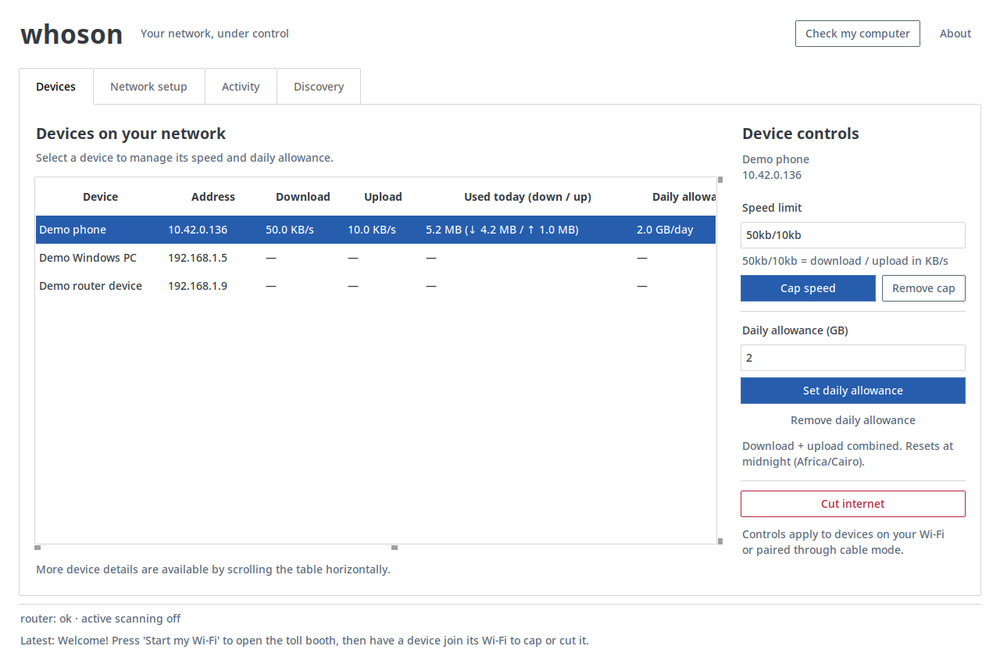

# whoson

**See who is connected. Control the traffic that passes through your laptop.**

whoson is a Python desktop app that turns a Linux laptop into a small network
control point. Share Wi-Fi with phones and tablets, or pair Ethernet-connected
Windows PCs, then set individual upload/download limits, daily data allowances,
and internet blocks.



> The Linux laptop hosts the gateway. Windows PCs use a single-file companion
> installer. The desktop widgets are cross-platform; hosting the gateway on
> Windows is not supported yet.

## What it does

- Shows connected devices, their addresses, connection type, and discovery source.
- Displays measured upload/download rates, refreshed about once per second.
- Sets separate download and upload speed caps for each controlled device.
- Tracks daily combined usage and enforces optional data allowances.
- Cuts and restores internet for hotspot devices and paired Windows PCs.
- Keeps router polling and active scanning separate from live traffic sampling.
- Provides a computer readiness check and an activity log.

### Which devices can be controlled?

| Connection | Discover | Measure, cap, or block |
| --- | --- | --- |
| Laptop's whoson Wi-Fi hotspot | Automatically | Yes, for routed IPv4 traffic |
| Ethernet-connected Windows PC with the paired helper | Automatically | Yes, for routed IPv4 traffic |
| Device connected directly to the router | Optional router polling or scanning | No, unless paired through the laptop |

Traffic must pass through the laptop for enforcement. Merely appearing in the
device list does not give whoson control over that device.

```text
Phone / tablet ── whoson hotspot ──┐
                                 ├── Linux laptop ── router ── internet
Paired Windows PC ── Ethernet ────┘
```

## Install on Linux

Requirements: Python 3.11+, Tk, NetworkManager, and Linux networking tools.
The gateway has been developed and exercised on Arch Linux. Other distributions
may need additional firewall configuration.

**Arch Linux**

```sh
sudo pacman -S python tk networkmanager iproute2 nftables iw dnsmasq hostapd
```

**Debian / Ubuntu**

```sh
sudo apt install python3 python3-venv python3-tk network-manager iproute2 nftables iw dnsmasq hostapd
```

Use Python 3.11 or newer (`python3 --version`), then clone and install:

```sh
git clone https://github.com/lodaq/whoson.git
cd whoson
python3 -m venv .venv
.venv/bin/python -m pip install -e .
./whoson
```

The launcher uses the project's virtual environment, even when launched through
a symlink from another directory. To make `whoson` available in your shell:

```sh
mkdir -p ~/.local/bin
ln -s "$(pwd)/whoson" ~/.local/bin/whoson
```

Ensure `~/.local/bin` is on your `PATH`. Networking operations need administrator
rights. If an action reports that authorization is missing, run `sudo -v` in a
terminal, then retry. Keep the desktop app running as your normal user.

## Share Wi-Fi

1. Open **Check my computer** to inspect the required tools and Wi-Fi support.
2. Under **Network setup**, open **Wi-Fi name & password…** and save your settings.
3. Click **Start my Wi-Fi**, then connect the devices you want to control.
4. Select a device under **Devices** to change its limits.

The adapter must support simultaneous hotspot and client operation when sharing
its existing Wi-Fi connection. whoson creates an `ap0` interface and uses
hostapd/dnsmasq for the hotspot, `tc` for shaping, and nftables for forwarding.

## Install on a Windows PC: one file

The PC must be connected by **Ethernet to the same router/network** as the laptop.

1. In the Linux app, enable **Network setup → Cable mode**.
2. Click **Save Windows installer…** and save `whoson-install.cmd` to a USB drive.
3. On Windows, double-click **that one file** and accept the administrator prompt.
4. Leave whoson open. The PC should appear with source **paired PC**.

**Do not run the source `.ps1` directly.** The exported `.cmd` contains the complete
helper and the pairing key for your laptop; no other file or download is required.
Generated installers are private and excluded from Git. A fresh GitHub clone does
not contain an installer: generate one in the app first.

The helper uses Windows PowerShell 5.1+ and runs as SYSTEM through Task Scheduler.
It retries discovery about every 10 seconds. When the laptop is unavailable, it
removes its temporary routes and returns to the original router routes. Existing
connections may need to reconnect. Reinstalling preserves the PC's identity.

Both machines need accurate clocks: messages more than 60 seconds apart are
rejected. If pairing fails, enable **Set time automatically → Sync now** in Windows
Date & time settings. The Linux Activity log reports authenticated clock mismatches.

For maintenance, use an administrator PowerShell window:

```powershell
# Inspect the installed helper
powershell.exe -NoProfile -ExecutionPolicy Bypass -File "$env:ProgramData\whoson\point-to-laptop.ps1" -Action status

# Remove the helper and its temporary routes
powershell.exe -NoProfile -ExecutionPolicy Bypass -File "$env:ProgramData\whoson\point-to-laptop.ps1" -Action remove
```

### Firewall setup

Allow UDP **47831** from your LAN to the laptop. The Windows installer creates a
scoped inbound rule for replies on UDP **47832**. The laptop firewall must also
permit forwarding from each paired PC.

Example for UFW; replace the interface, subnet, and PC address with your own:

```sh
sudo ufw allow in on wlan0 from 192.168.1.0/24 to any port 47831 proto udp
sudo ufw route allow in on wlan0 out on wlan0 from 192.168.1.50
```

The forwarding rule must follow the PC's current address if DHCP changes it.
whoson does not automatically manage UFW rules. Network client isolation can
prevent discovery between Ethernet and Wi-Fi devices.

## Speeds and daily allowances

The speed field takes **download/upload** values:

| Value | Meaning |
| --- | --- |
| `50kb/10kb` | 50 KB/s download, 10 KB/s upload |
| `100kb/20kb` | 100 KB/s download, 20 KB/s upload |
| `5/1` | 5 Mbit/s download, 1 Mbit/s upload |

Rates come from kernel byte counters divided by actual elapsed time, not the
configured speed cap. Download is traffic **to** the device; upload is traffic
**from** it. Local-network traffic and the laptop's own traffic are excluded.
Network headers are counted, so readings can differ from browser file-transfer rates.
A dash means whoson cannot measure that device's traffic.

Daily allowances combine upload and download. Enter a GB amount and select
**Set daily allowance**. Totals reset at midnight in the configured usage timezone
(default: `Africa/Cairo`), on the first update after midnight. Removing a limit
preserves today's totals. Changing the speed cap does not change the allowance.

## Discovery and router logs

The **Discovery** tab offers two independent settings:

- **Active network scanning:** off by default. Sends connection probes across the
  local subnet when router discovery is unavailable. The current burst scanner
  can trigger router scan/flood warnings; leave it off while investigating outages.
- **Automatic router polling:** on by default. Uses a saved router login to request
  the connected-device list. The current integration targets Huawei HG630 V2 / WE
  firmware; compatibility with other routers is not established.

Save changes and restart whoson. Turn both options off to minimize automatic
router-facing discovery activity. Hotspot devices and paired PCs still work, but
other router-side devices will not be discovered automatically. Manually testing
a router password or running the computer check still makes the requested probes.

## Limits and privacy

- **IPv4 only.** IPv6, VPN routing, or connections bypassing the laptop can escape
  monitoring and enforcement. This is not a tamper-proof parental-control system.
- The laptop must stay on for enforcement. A paired PC falls back to the router
  when whoson is unavailable, so that traffic is outside its limits.
- Sharing one Wi-Fi radio can reduce throughput; stability depends on the adapter,
  driver, router, and firewall. Router/ISP outage causes need separate diagnosis.
- Settings and credentials are stored locally in `~/.config/whoson/`. The config
  file is owner-readable only, but stored router passwords are not encrypted.
- Windows pairing uses HMAC-SHA256, fresh nonces, and timestamps. Keep generated
  installers private: anyone holding one also holds its shared pairing key.
- The legacy router client accepts the router's self-signed TLS certificate;
  certificate validation is disabled for that integration.
- Use this tool only on networks and devices you own or are authorized to manage.

For terminology, see [GLOSSARY.md](GLOSSARY.md).

## Development and verification

```sh
# Unit tests; no admin rights required
.venv/bin/python -m unittest discover -s tests

# Desktop smoke check with fake services, inside an isolated X server
xvfb-run -a .venv/bin/python -m tests.check_desktop_ui

# Real kernel packet tests, isolated from the host network
unshare -Urn .venv/bin/python -m tests.check_usage_kernel
unshare -Urn .venv/bin/python -m tests.check_tc_kernel
unshare -Urn .venv/bin/python -m tests.check_paired_rates_kernel

# PowerShell checks; route commands are mocked
pwsh -NoProfile -File tests/windows-helper.tests.ps1
.venv/bin/python -m tests.check_windows_setup
```

The desktop check needs Xvfb. Packet checks need Linux user/network namespaces
and the networking tools listed above. PowerShell tests also run under `pwsh`
on Linux, but do not replace physical Windows testing. Pairing has been observed
on a Windows 10 PC; broader Windows startup, adapter, VPN, and recovery coverage
remains limited.

| File | Responsibility |
| --- | --- |
| `main.py`, `ui.py` | Desktop controller and modular Tk/ttkbootstrap workspace |
| `tollbooth.py`, `commands.py` | Linux gateway actions and command construction |
| `usage.py` | Byte counters, live rates, and daily quotas |
| `watch.py`, `router.py`, `scanner.py` | Device snapshots and optional discovery |
| `companion.py` | Authenticated pairing and single-file installer export |
| `resources/point-to-laptop.ps1` | Internal Windows helper source |
| `settings.py`, `speeds.py`, `makers.py`, `helpers.py` | Preferences, parsing, vendor lookup, checks |
| `tests/` | Unit, desktop, PowerShell, and isolated kernel checks |
